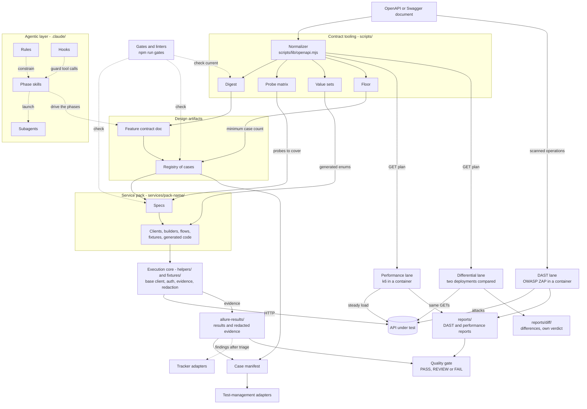
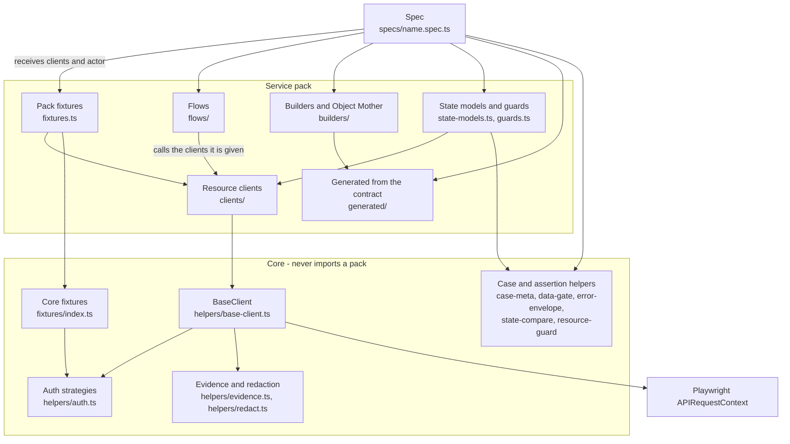
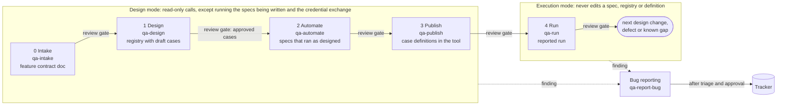
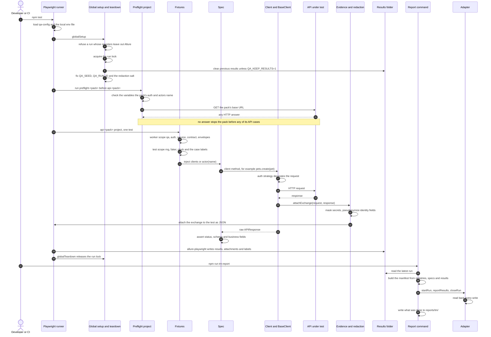
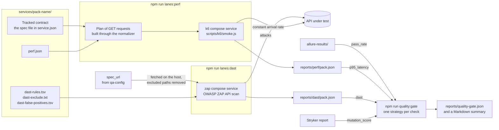
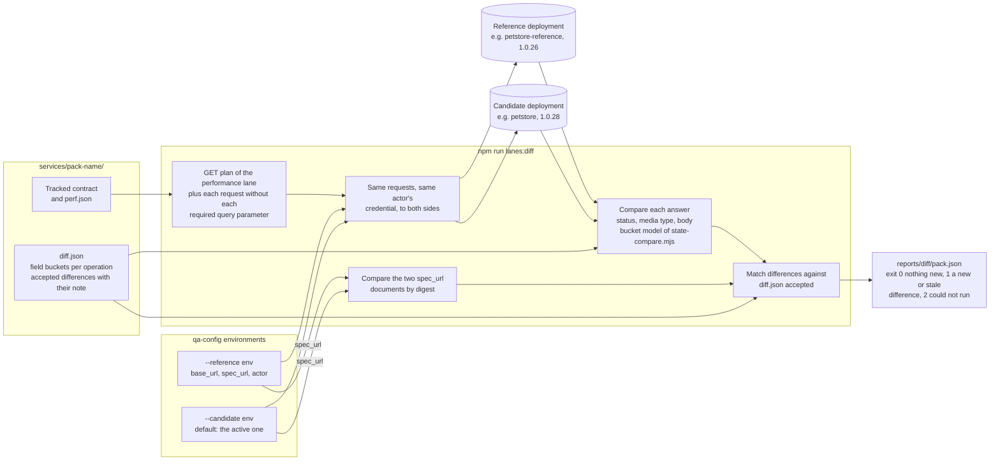

# Architecture

How the framework is put together: the building blocks and how they connect, the layers of the
test code, the phases that move work on an API forward, what happens during a run, the patterns the
code uses and where to extend it. The page explains structure; the decisions behind it are recorded
in the [ADRs](adr/README.md), and the [onboarding tour](onboarding.md) maps the repository folder by
folder. Each section links to the file that owns the detail instead of repeating it.

## The big picture

The framework turns an API contract into reviewed test cases, runs them as Playwright specs, and
sends results and defects to the tools a team already uses. An agentic layer can drive that work
through phases, inside guardrails.

Reading the diagram from the top:

- **Contract tooling.** Every tool reads the API description through one normalizer, so Swagger 2.0,
  OpenAPI 3.0 and OpenAPI 3.1 give the same results ([ADR 0003](adr/0003-openapi-normalizer.md)).
  From the normalized model come the tracked digest (what the contract looks like, used to detect
  drift), the probe matrix (negative and boundary probes per operation), the value sets (closed
  sets of values, generated into TypeScript) and the floor (the minimum number of cases per
  operation). [Contract tooling](contract-tooling.md) lists the commands and their outputs.
- **Design artifacts.** A feature contract doc completes what the OpenAPI document leaves out, and
  a registry lists the designed cases with a technique, a priority and a status. The format is in
  [the registry rule](../.claude/rules/registry.md).
- **Service pack.** Each API under test lives in `services/<pack>/`, with its specs and the code
  they need ([ADR 0007](adr/0007-layered-test-architecture.md)). `services/petstore/` is the worked
  example; `services/vampi/` is a second pack, with login authentication and an authorization
  matrix, and `services/keycloak/` a third, with OAuth 2.0 client credentials from the identity
  provider it tests.
- **Execution core.** `helpers/` and `fixtures/` hold everything that is the same for every API:
  the base client, authentication, evidence and redaction, schema validation, seeded data. The core
  never imports from a pack (`lint-layers` checks it).
- **Results and tools.** A run writes results and redacted evidence to `allure-results/`. A neutral
  case manifest joins them with the registries and feeds the configured test-management adapter
  ([ADR 0004](adr/0004-test-management-adapters.md)). Defects go to the configured tracker through
  another adapter. Both are described in [test management](test-management.md).
- **Lanes and the quality gate.** Three lanes test a pack without Playwright: OWASP ZAP scans the
  operations of the OpenAPI document, k6 sends a plan of `GET` requests built from the normalized
  contract, and the differential lane sends the same plan to two deployments and compares their
  answers. The DAST and performance reports and the test results feed the quality gate, which gives
  each configured check a verdict; the differential lane gives its own
  ([lanes and the quality gate](#lanes-and-the-quality-gate)).
- **Gates.** `npm run gates` checks the specs, the registries, the docs and the freshness of the
  contract outputs without calling the API ([quality gates](quality-gates.md)).
- **Agentic layer.** Rules, phase skills, subagents and hooks let a coding agent run the phases with
  a human review gate after each one ([`CLAUDE.md`](../CLAUDE.md) lists them). Everything below the
  agentic layer also works without an agent; the [adoption levels](../README.md#adoption-levels)
  say which parts you can skip.

## Layers of the test code

Inside a pack, test code is layered so that a spec states what is tested and nothing about how a
request is built. [ADR 0007](adr/0007-layered-test-architecture.md) defines the layers, and
[the generation rule](../.claude/rules/generation.md) says which concern goes where. The arrows
below are real import or call directions in `services/petstore/`, `helpers/` and `fixtures/`.

| Layer | May | May not |
|---|---|---|
| Spec (`services/petstore/specs/`) | take clients and `actor(name)` from the pack fixtures; call flows; take data from builders; assert status, schema (`toMatchSchema`), error envelope and business fields; use the core helpers for metadata, data gates, state comparison and known gaps | build a URL or a header, send a request itself, use `Math.random` or `Date.now()`, type a value set from memory, attach raw bodies, import another spec, read files at import time |
| Pack fixtures (`services/petstore/fixtures.ts`) | extend the core `test` with the pack's manifest, contract validator, error envelopes and clients; bind the clients to a named credential (`actor`); label every case with its identity | hold test logic |
| Flows (`services/petstore/flows/`) | run a multi-step precondition over the clients they are given, one named step each, stopping on an unexpected status (`expectStatus` in `helpers/flow.ts`) | assert what the case is about; create clients |
| Clients (`services/petstore/clients/`) | name the paths of one resource and return the raw response | judge a status; know which credential is in use |
| `BaseClient` (`helpers/base-client.ts`) | apply the auth strategy, encode path parameters, send raw bodies byte for byte, attach redacted evidence | know anything about a particular API |
| Builders (`services/petstore/builders/`) | build request data from the seeded `faker` and `clock`, with values from `generated/enums.ts` through the pack's types | send requests |
| State models and guards (`services/petstore/state-models.ts`, `services/petstore/guards.ts`) | classify fields into buckets for comparison; capture and restore shared records | decide a case's verdict on their own |

What the code shows beyond the layer list in ADR 0007:

- **Actors are a fixture, not a folder.** `actorSession` in `fixtures/index.ts` opens one request
  context per credential, and `actor(name)` in the pack fixtures binds the same clients to it.
- **A spec may skip layers.** A simple case uses a client fixture directly, and flows are opt-in.
  Specs also import core helpers directly (case metadata, data gates, envelopes, state comparison).
  The rule that holds everywhere in a pack is narrower: only clients send HTTP, and only through
  `BaseClient`. Flows, guards and cleanup helpers call client methods; no spec uses the raw
  `request` fixture.
- **The core reaches into `scripts/lib/` but never into a pack.** `helpers/schema.ts` uses the
  normalizer, `helpers/case-meta.ts` uses the text helpers and `fixtures/global-setup.ts` uses the
  run id from the logger.

## The phases

Work on an API moves through phases. Each one produces an artifact that a person reviews before the
next starts, and the phases fall into two modes that never mix. [`AGENTS.md`](../AGENTS.md#the-process)
owns the list of phases, and [the modes rule](../.claude/rules/modes.md) owns what each mode may do.

- Each phase is a skill in `.claude/skills/`, so the agent loads its instructions when the phase
  starts. Without an agent, the same skills are readable instructions you follow by hand.
- The registry status moves with the phases: `draft` at design, `approved` at its gate, `automated`
  once a reviewed spec proves the case, `published` once the definition is in the tool
  ([status lifecycle](../.claude/rules/registry.md#status-lifecycle)).
- During automate, `qa-automate` can hand each spec file to a `spec-author` subagent, and every new
  or changed spec is reviewed by a fresh `api-spec-reviewer` subagent. Intake and bug triage can
  launch a `contract-investigator` for one contract discrepancy. Subagents return reports; approvals
  stay in the conversation.
- A tool that keeps no case definitions (the default `allure-report`) has nothing to publish, so
  `tm:publish` skips that phase with a notice.
- Bug reporting branches off any phase. It writes to the tracker, never to the system under test
  ([bug reporting](references/bug-reporting.md), [defect rubric](references/defect-rubric.md)).

## A run, end to end

What `npm test` does, step by step, and how its results reach a test-management tool. Every step is
in `playwright.config.ts`, `fixtures/`, `helpers/` and `scripts/tm/`.

Notes on the steps:

- **Projects.** `npm test` runs the projects defined in `playwright.config.ts`: `unit`, and for
  each pack under `services/` (a folder with a `service.json`) a `preflight-<pack>` setup project
  and an `api-<pack>` project that depends on it (and, only under `npm run auth:live`, the
  `auth-live` project). `--project=api-<pack>` runs one pack and
  `--project=api-*` every pack. Each `api-<pack>` project leaves out `@destructive` and
  `@quarantine` cases (`projectTagFilter` in `scripts/lib/tags.mjs`), which only
  `npm run lanes:destructive` and `npm run lanes:flake` run ([lanes](quality-gates.md#lanes)).
- **Configuration per pack.** A pack's projects read its entry in the active environment
  (`api.environments.<env>.packs.<pack>`, [ADR 0009](adr/0009-per-pack-configuration.md)): base
  URL, contract URL, credentials, actors and `allow_writes`; the destructive lane reads its
  `recovery`. The pack name comes from the project's metadata; the core never names a pack.
- **Global setup** (`fixtures/global-setup.ts`) checks before it deletes anything: a run whose
  reporters would record nothing fails with the old results still on disk. The run lock
  (`helpers/run-lock.ts`) keeps a second local run from clearing the first one's results.
- **The preflight** (`fixtures/preflight.setup.ts`) turns a missing variable, a pack the
  environment does not configure, or a host that does not answer into one readable failure for
  that pack. A pack that is not selected never blocks the run. Any HTTP status counts as an answer
  ([the reachability rule](../.claude/rules/reachability.md)).
- **Case labels.** The pack's automatic `caseMeta` fixture calls `applyCaseMeta` in
  `helpers/case-meta.ts`, which gives each result its suite, its run id and, when the title starts
  with a case id, the identity `<service>-<version>-<TC id>`. What a result carries is set by
  [the reporting rule](../.claude/rules/reporting.md).
- **Authentication.** The strategy the pack's `auth` or the actor names decorates each request
  (`helpers/auth.ts`). The token strategies (`login`, `oauth2_client_credentials`) obtain a token on
  their first request, reuse it and renew it shortly before it expires; when a request they
  decorated answers `401`, `BaseClient` asks for a new token and sends the request once more; a
  credential the caller set is never renewed. The token exchange is not recorded as evidence ([authentication strategies](guides/add-a-service-pack.md#4-authentication-strategies)).
- **Evidence.** `BaseClient.send` calls `attachExchange` in `helpers/evidence.ts` for every request.
  Secrets are masked and identity fields are pseudonymized with a per-run salt (`helpers/redact.ts`)
  before anything is attached. Global setup draws the salt and puts it in `QA_ANON_SALT` for the
  workers, keeping a value already set; it is never printed, so do not set it except to compare
  pseudonyms across runs. Playwright traces are not redacted; [CI](ci.md#secrets-and-variables)
  explains what that means for a real credential.
- **Reporting.** `scripts/tm/run.mjs` builds the manifest (`scripts/tm/manifest.mjs`), continues the
  run id the results were recorded under, loads the adapter named by `test_management.provider`, and
  closes the run even when reporting failed. Results without an identity are listed with a reason,
  never dropped.

## Lanes and the quality gate

A normal run proves what the cases assert. Lanes answer other questions about the same pack, and
the quality gate turns their outputs into one verdict. The Playwright lanes (known gaps, published
cases, flakiness, destructive cases) select and repeat specs. Two more run tools that are not
Playwright, and a third compares two deployments. [Quality gates](quality-gates.md#lanes) owns what
each lane does and how it exits; [ADR 0010](adr/0010-container-lanes.md) records why the tools run
in containers and why the gate, not the lane, judges thresholds.

- **Tools in containers.** ZAP and k6 run from compose services pinned by digest, behind the
  profiles `dast` and `perf`, so their versions live in `docker-compose.yml` and no one installs
  them ([ADR 0010](adr/0010-container-lanes.md)). Inside a container `localhost` is the container itself, so `scripts/lib/container.mjs`
  rewrites a loopback base URL to the compose service that publishes its port, or to
  `host.docker.internal`, and the lane prints the rewrite.
- **The contract drives both.** The DAST lane fetches the pack's OpenAPI document from its
  `spec_url` on the host, removes the paths `dast-exclude.txt` matches and hands ZAP the saved
  file, which attacks every operation at the pack's base URL. The performance lane builds its plan from the
  tracked contract through the normalizer: every `GET` with values from `perf.json`, the schema's
  examples, defaults or enums, and every operation it leaves out printed with its reason.
- **Each pack sets its own policy.** `dast-rules.tsv` sets each ZAP rule to IGNORE, WARN or FAIL,
  `dast-exclude.txt` keeps URLs out of a scan, `dast-false-positives.tsv` filters alerts shown to
  be false, and `perf.json` gives parameter values and keeps out operations that reset data or
  expose secrets. Every file is optional: the VAmPI pack has the DAST files and `perf.json`; the
  Petstore has `dast-false-positives.tsv`, `perf.json` and the differential lane's `diff.json`; the
  Keycloak pack has `perf.json`.
- **The pack's credential goes along.** Both lanes send the credential of one of the pack's actors,
  obtained on the host by `scripts/lib/auth-tokens.mjs`, the code the test runner's strategies use.
  For ZAP the lane sets it as a replacer rule through ZAP's API and renews it during the scan; for
  k6 it travels in the container's environment, never on disk ([credentials in the
  lanes](quality-gates.md#credentials-in-the-dast-performance-and-differential-lanes)).
- **The lane judges what it can, the gate judges thresholds.** A lane fails on what is wrong in
  itself: an alert of a FAIL rule, an API that stopped answering during a scan, a request that
  answered an unexpected status, a difference the pack has not accepted. Counts and
  percentiles are judged once, by the quality gate's strategies in `scripts/quality-gate.mjs`, with
  the thresholds in qa-config `quality_gate`.
- **Two deployments, compared.** The differential lane (`npm run lanes:diff`) sends the
  performance lane's `GET` plan to two qa-config environments of a pack and compares the answers
  with the bucket model of `scripts/lib/state-compare.mjs`, the code `helpers/state-compare.ts`
  gives the specs, and the two contracts with the digest. It needs no tool container and feeds no
  check of the gate: a difference the pack has not accepted in `diff.json` fails the lane. The
  diagram below shows it.
- **A scan writes, so it asks the environment first.** The DAST lane scans only where the pack's
  entry has `allow_writes: true`, uses the pack's `workers` as ZAP's threads per host, and runs the
  entry's `recovery` afterwards, the same settings the specs and the destructive lane obey.
- **CI runs them on a schedule.** `dast.yml` scans both VAmPI modes and the Petstore, `perf.yml`
  runs the Petstore and VAmPI and `diff.yml` compares the Petstore with an earlier release every week, and on
  pull requests that touch them ([continuous integration](ci.md)).

The differential lane compares a candidate deployment with a reference. Both are qa-config
environments with an entry for the pack; the `QA_<PACK>_*` overrides move the candidate only.

- **Read-only on both sides.** Only `GET` requests are sent, so the lane may run against shared
  environments. The report names the field paths that differ, never their values.
- **A reviewed difference stays reviewed.** An accepted difference that no longer shows up fails
  the lane too, so `diff.json` cannot keep entries for changes that are gone.

## Patterns used

Each pattern below is in the code today; the path is where to read it.

**Test code**

| Pattern | Where | Why |
|---|---|---|
| Layered test architecture | `services/petstore/specs/`, `services/petstore/flows/`, `services/petstore/clients/`, `helpers/base-client.ts` | Specs state intent, lower layers own the mechanics, so specs stay short and easy to generate and lint. |
| Plugin architecture: service packs | `services/petstore/`, `scripts/scaffold-service.mjs` | A new API is a new folder; the core never imports from a pack. |
| Service Object over a base client | `services/petstore/clients/pet-client.ts` extends `helpers/base-client.ts` | One client per resource names paths; the base owns auth, encoding and evidence. |
| Actor: clients bound to a credential | `actorSession` in `fixtures/index.ts`, `actor` in `services/petstore/fixtures.ts` | Authorization cases compare callers with their own request contexts, so cookies never leak. |
| Facade: flows | `services/petstore/flows/purchase.ts`, `helpers/flow.ts` | A multi-step precondition reads as one call and fails with the step that broke. |
| Fixtures as dependency injection | `fixtures/index.ts`, `services/petstore/fixtures.ts` | Configuration, clients, randomness and time reach a spec as parameters, never as globals. |
| Strategy: authentication | `factories` in `helpers/auth.ts` | Clients never know the scheme; a new scheme is one entry. |
| Fail-fast preflight | `fixtures/preflight.setup.ts` | A missing variable or an unreachable host gives one clear failure instead of every case timing out. |
| Visible skips and data gates | `helpers/data-gate.ts` | A skip carries its reason; data in the wrong state fails the case instead of letting it pass. |

**Test data and state**

| Pattern | Where | Why |
|---|---|---|
| Test Data Builder and Object Mother | `services/petstore/builders/pet-builder.ts`, `services/petstore/builders/mother.ts` | Valid data by default, one change per variant, named variants shared by specs. |
| Seeded randomness and an injected clock | `helpers/rng.ts`, `helpers/clock.ts`, the `rng`, `faker` and `clock` fixtures | Each test's seed is recorded, so a failure replays with the same data; `QA_CLOCK` pins "now". |
| Field buckets for state comparison | `helpers/state-compare.ts`, `services/petstore/state-models.ts` | Identity and business fields must match, volatile ones are never compared, unknown fields are reported. |
| Resource guard | `helpers/resource-guard.ts`, `services/petstore/guards.ts` | Shared records are captured, compared and repaired after a case, and an unexpected change is a finding. |
| Cleanup confirmed by a read | `services/petstore/flows/cleanup.ts` | A delete's own status can prove nothing; the read after it does. |
| Redaction and pseudonymization | `helpers/redact.ts`, `helpers/evidence.ts`, `helpers/anonymize.ts` | Evidence keeps its value for debugging without carrying credentials or personal data. |
| Run lock | `helpers/run-lock.ts` | Two local runs cannot clear or mix each other's results. |

**Contract**

| Pattern | Where | Why |
|---|---|---|
| Normalizer as an anti-corruption layer | `scripts/lib/openapi.mjs`, used by `helpers/schema.ts` and every contract tool | Spec-version differences are handled once; no tool reads a raw document ([ADR 0003](adr/0003-openapi-normalizer.md)). |
| Code generated from the contract | `scripts/derive-value-sets.mjs` writing `services/petstore/generated/enums.ts`, `scripts/scaffold-service.mjs` | Literal values and first clients come from the contract, not from memory; `contract:check` fails when they are stale. |
| Decision tables driving data-driven specs | `services/petstore/rules/`, `scripts/derive-decision-tables.mjs`, `services/petstore/generated/decision-tables.ts`, `services/petstore/specs/pet-search.spec.ts` | Combinations of conditions are checked for completeness and consistency, then a spec runs one step per rule. |
| Error envelope catalog | `helpers/error-envelope.ts`, `services/petstore/error-envelopes.json` | Error shapes are declared once per API and checked on every negative case. |
| Stable case identity | `caseIdentity` in `helpers/case-meta.ts` | Results follow the designed case id, not the file or the title, so refactors do not orphan history. |
| Known-gap arming | `knownGap` in `helpers/case-meta.ts`, `scripts/known-gap-lane.mjs` | A known defect keeps its case red on purpose, linked to its issue, and a gap that starts passing is reported. |
| Load plan generated from the contract | `derivePlan` in `scripts/perf-lane.mjs`, `scripts/k6/smoke.js` | The k6 script stays fixed and the operations it sends come from the contract, so a new `GET` is measured without editing a script, and every operation left out says why. |

**Integration and process**

| Pattern | Where | Why |
|---|---|---|
| Adapter with a shared contract test: test management | `scripts/tm/adapter.mjs`, `scripts/tm/adapters/`, `scripts/tm/contract.mjs` | One neutral interface and manifest; a new tool is one adapter that passes the same contract ([ADR 0004](adr/0004-test-management-adapters.md)). |
| Adapter with a shared contract test: trackers | `scripts/tracker/adapters/`, `scripts/tracker/contract.mjs` | GitHub, Jira and the local store behave the same behind one interface. |
| Read-back after every write | `verifiedTracker` in `scripts/tracker/tracker.mjs` (a decorator over any tracker adapter), `assertReadBack` in `scripts/tm/adapter.mjs` | A write that says it worked is checked against what the tool now holds. |
| Strategy: quality-gate checks | `STRATEGIES` in `scripts/quality-gate.mjs` | Each metric reads and judges its own source; the worst verdict wins. A check can read more than one format: `p95_latency` takes a k6 summary or Allure results. |
| Tools pinned in containers | the `zap`, `k6` and `petstore-reference` services in `docker-compose.yml`, behind profiles ([ADR 0010](adr/0010-container-lanes.md)) | A scanner, a load tool or a reference deployment has one version, pinned by digest, and nothing to install on a machine or a CI runner. |
| Address translation for containerised tools | `reachableBase` in `scripts/lib/container.mjs`, used by `scripts/dast-lane.mjs` and `scripts/perf-lane.mjs` | A base URL that works on the host is rewritten once, the same way for every tool, and printed. |
| Exact self-tests for linters | `scripts/lib/lint.mjs`, `scripts/__fixtures__/` | A linter passes only when it reports exactly the marked lines, so missed defects and false alarms both fail. |
| Design and execution separation | `.claude/rules/modes.md` | Design never writes to the system under test; a run never edits what defines it. |
| Hooks as guardrails | `.claude/hooks/`, registered in `.claude/settings.json` | Credentials in prompts, tool calls and output are refused or masked, and the configured git policy is applied, whatever the agent intends ([ADR 0005](adr/0005-claude-code-hooks.md)). |

## Extension points

- **A new API (service pack):** `npm run scaffold:service`, then the
  [add a service pack](guides/add-a-service-pack.md) guide.
- **A new test case:** the [add a test case](guides/add-a-test-case.md) guide, from the contract
  doc to a reported run.
- **An authentication scheme:** a new entry in `factories` in `helpers/auth.ts` for a scheme that
  sends one variable's secret, or its own builder in `createAuth` for a credential pair or a token;
  either way with its config type and schema branch, and `laneCredential` for the lanes
  ([authentication strategies](guides/add-a-service-pack.md#4-authentication-strategies)).
- **A test-management tool:** copy `scripts/tm/adapters/local/index.mjs`, register it in
  `scripts/tm/adapters/index.mjs` and pass `scripts/tm/contract.mjs`
  ([writing an adapter](test-management.md#writing-an-adapter-testrail-and-others)).
- **An issue tracker:** an adapter in `scripts/tracker/adapters/`, registered in
  `scripts/tracker/index.mjs`, that passes `scripts/tracker/contract.mjs`
  ([issue trackers](test-management.md#issue-trackers)).
- **A pack's lane policy:** the optional files of
  [what a pack holds](../.claude/rules/service-packs.md#what-a-pack-holds), in the pack folder
  ([lanes](quality-gates.md#lanes)).
- **A quality-gate check:** a new strategy in `STRATEGIES` in `scripts/quality-gate.mjs`, with its
  settings in `schemas/qa-config.schema.json` ([quality gate](quality-gates.md#quality-gate)).
- **Consumer-driven contracts:** not implemented; a provider verification lane with provider states
  built from the pack's layers, and a gate check on its report, is designed in
  [consumer-driven contracts](guides/consumer-driven-contracts.md).
- **A linter rule:** a rule in `scripts/lint-harness.mjs`, `scripts/lint-suite.mjs`,
  `scripts/lint-docs.mjs` or `scripts/lint-layers.mjs`, with fixtures in `scripts/__fixtures__/` that contain the defect and
  look-alikes that do not ([linters](quality-gates.md#linters)).
- **A decision table:** a YAML file in the pack's `rules/` folder, generated with
  `npm run contract:decision-tables` ([decision tables](contract-tooling.md#decision-tables)).
- **A secret pattern for the hooks:** `.claude/hooks/lib/secrets.mjs`
  ([hooks README](../.claude/hooks/README.md)).
- **A rule, skill or subagent:** register it as
  [the documentation rule](../.claude/rules/documentation.md) says, and walk its propagation table
  in the same change.
