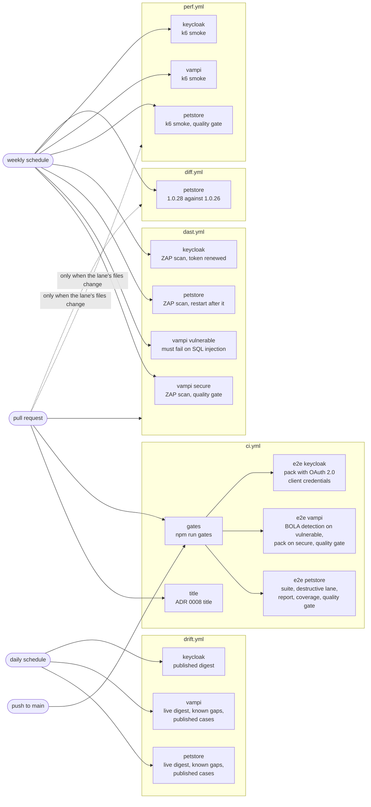

# Continuous integration

Five GitHub Actions workflows run the framework's checks against the example packs: `ci.yml` on
every pull request and every push to `main`, `drift.yml` once a day, and `dast.yml`, `perf.yml` and
`diff.yml` once a week. Each starts the APIs it needs in Docker on the runner, the same way a
contributor does (`npm run petstore:up`, `npm run vampi:up`, `npm run keycloak:up`,
`npm run petstore:reference:up`). The other four workflows (CodeQL, the secret scan, the AI review,
the publishing of `create-api-qa`) are in [CI security and review](ci-security.md). The commands they call are described in
[quality gates](quality-gates.md), [contract tooling](contract-tooling.md) and
[test management](test-management.md); this page covers the order and the reasons. The `ci.yml`
and `drift.yml` runs also exist as Jenkins pipelines ([Jenkins](#jenkins)).

| Workflow | Trigger | Jobs |
|---|---|---|
| `.github/workflows/ci.yml` | `pull_request`, `push` to `main` | `title` (pull requests only), `gates`, then `e2e (petstore)`, `e2e (vampi)` and `e2e (keycloak)` |
| `.github/workflows/drift.yml` | daily `schedule`, `workflow_dispatch` | `drift (petstore)`, `drift (vampi)`, `drift (keycloak)` |
| `.github/workflows/dast.yml` | weekly `schedule`, `workflow_dispatch`, `pull_request` | `dast (vampi secure)`, `dast (vampi vulnerable)`, `dast (petstore)`, `dast (keycloak)` |
| `.github/workflows/perf.yml` | weekly `schedule`, `workflow_dispatch`, pull requests that touch its `paths` | `perf (petstore)`, `perf (vampi)`, `perf (keycloak)` |
| `.github/workflows/diff.yml` | weekly `schedule`, `workflow_dispatch`, pull requests that touch its `paths` | `diff (petstore)` |

A lane workflow's `paths` list, in the workflow file, owns which files trigger it on a pull request:
the lane, the scripts it imports and `scripts/lib/`, the pack files it reads,
`qa-config.example.json`, `docker-compose.yml` and the workflow itself. A workflow whose jobs are
required checks has no such list, because a required check that does not run leaves the pull
request waiting ([required checks](#required-checks)).



Solid arrows are the regular triggers; every scheduled workflow also runs on `workflow_dispatch`.

## `ci.yml`

### `title`

On a pull request only: the title has to follow ADR 0008 (`type(scope): <BACKLOG-ID> summary`),
because `main` takes squash merges and the title becomes the commit subject there. It runs
`scripts/commit-title.mjs`, which uses the changelog's parser, with the title passed through an
environment variable so a title cannot inject shell code. Dependabot's pull requests skip it: their
titles cannot carry a backlog id.

### `gates`

Checkout with the full history (`lint-docs` checks each closing commit of the backlog against it,
and reports a shallow clone), Node from `.nvmrc` with the npm cache, `npm ci`, `npm run gates`.
The gates need no API,
so a broken lint, type, contract or linter check fails in minutes, before any container starts. This
is the same command as the pre-push hook: a gate counts only if its failure blocks (L-49).

No gate needs a binary that the runner lacks. Gitleaks is called only by the git hooks through
`scripts/secret-scan.mjs`; the gates need only git and Node. In Actions the secret scan is a
workflow of its own (`secret-scan.yml`, see [CI security](ci-security.md)).

### `e2e`

Runs only when `gates` passed. Every step fails the job when its command fails. There is no
`continue-on-error`, and the reporting steps that run after a failure do not turn the job green.

| Step | Why |
|---|---|
| Provide `API_KEY` | The variable that the `petstore` pack's `auth.env` names in qa-config. See [secrets and variables](#secrets-and-variables). |
| `npm run petstore:up` | Starts the pinned Petstore image and waits for its healthcheck. |
| `npx playwright test --project=api-petstore` | The `api-petstore` project, after its `preflight-petstore` project: the job starts only the Petstore; VAmPI runs in [`e2e-vampi`](#e2e-vampi). When the API is not answering, the preflight fails once with the reason and no case runs. `@destructive` and `@quarantine` cases are left out. |
| `npm run lanes:destructive -- --service petstore` | Last. Each `@destructive` case runs alone and is followed by its pack's recovery, a restart of the container, and a wait until the API answers (L-59). Its results join the run above under the same run id. |
| Rebuild the local tool's definitions | Only for the example's `local` tool: its store (`reports/tm/local`) is not tracked, so a fresh runner starts empty, and `npm run tm:publish` rebuilds the definitions from the registries. A real definitions-first tool is published by `qa-publish` after its review gate, never by CI; a results-first tool (Allure TestOps) needs no definitions. |
| `npm run tm:report -- --service petstore` | Reports the suite and the destructive lane as one run to the configured tool. |
| `npm run coverage:status` | The gates ran it without results. Here it also checks that every published case has a result in this run and that no blocked case passed. |
| `npm run quality:gate` | The verdict from `qa-config.quality_gate`. A FAIL fails the job, a REVIEW does not. The Markdown summary is added to the job summary. |

The destructive lane, the report, the coverage check and the quality gate run even when the suite
failed. A failed run is still reported as one run, and the lane completes it. They do not run when
the suite never started, for example because the Petstore did not start. The job sets `QA_RUN_ID` to
`gh-<run id>-<attempt>`, so the results, the tool logs and the run in the test-management tool all
carry the id of the workflow run (L-48).

The suite uses only Playwright's API client, so no browser is installed (`playwright install` is not
needed).

### `e2e-vampi`

The second pack (CI-08), in a job of its own so that each pack has its own required check
([required checks](#required-checks)). Both VAmPI modes run from one pinned image on the same
runner.

| Step | Why |
|---|---|
| Provide the VAmPI users | `VAMPI_USER_A_*` and `VAMPI_USER_B_*`, the users behind actors `user-a` and `user-b`: throwaway values per run (the pack registers them on a fresh container), passwords masked. |
| `npm run vampi:up` | Starts both modes and creates their databases (VN-01). |
| BOLA detection on the vulnerable mode | Runs `specs/books-authorization.spec.ts` with `QA_ENV=local-vulnerable` and passes only when TC-BOOK-02 is the one case that failed (`services/vampi/check-bola-detection.mjs`, VN-09): a matrix that stops failing there has stopped detecting the flaw. First, because every run clears `allure-results/`. |
| `npx playwright test --project=api-vampi` | The pack on the secure mode, after `preflight-vampi`. |
| `npm run coverage:status`, `npm run quality:gate`, the Allure report | As in `e2e`, on the secure-mode run. The run is not reported to the test-management tool; only the Petstore's is. |

### `e2e-keycloak`

The third pack (FUT-15), whose `oauth2_client_credentials` auth gets its tokens from the token
endpoint of the Keycloak it tests. It is not a required check.

| Step | Why |
|---|---|
| Provide the Keycloak clients | `KEYCLOAK_*_CLIENT_ID` and `KEYCLOAK_*_CLIENT_SECRET` of the realm's three service-account clients, behind actors `admin`, `viewer` and `no-role`: throwaway secrets per run, masked. |
| `npm run keycloak:up` | Starts Keycloak in development mode; it imports `services/keycloak/realm/qa-realm.json` with those secrets (`services/keycloak/up.mjs` refuses to start without them). |
| `npx playwright test --project=api-keycloak` | The pack, after `preflight-keycloak`. No test-management report, coverage check or quality gate follows it. |

### Why docker compose and not a service container

The backlog item asked for a service container. The workflow starts the Petstore with
`docker compose` instead. The destructive lane recovers the service with the `recovery.command` of
the pack's entry in the environment, which for `petstore` in `local` is
`docker compose restart petstore`. That command only works on a container started by compose from
`docker-compose.yml`. A service container is created by the runner under a generated name, and
compose cannot restart it. Compose also keeps the image tag in one place, the file a contributor
uses locally.

Each workflow sets its own `COMPOSE_PROJECT_NAME`. Stopping and restarting then touch only the
container that run started, even where the Docker daemon is shared, as under `act`.

### Pull requests and concurrency

A new push to a pull request cancels the run it supersedes. Runs on `main` always finish. The
`GITHUB_TOKEN` has `contents: read` only.

## `drift.yml`

The contract can change without notice (L-28), and published cases are re-run when it does and
periodically even when it does not (L-31). Each pack with a tracked digest has a job of its own
(CI-17), so a drift or a failing lane shows under the pack's name and does not hide another pack's
result.

| Job | The live contract it compares | What it runs |
|---|---|---|
| `drift (petstore)` | the `spec_url` of the pack's entry in the default environment, or in `QA_DRIFT_CONTRACT_ENV` ([which contract](#which-contract-is-compared)) | the steps below, against the Petstore it starts |
| `drift (vampi)` | the document the VAmPI container serves (`spec_url` in the default environment), from the image pinned by digest in `docker-compose.yml` | the same steps, against VAmPI's secure mode; it starts VAmPI for the digest too, with throwaway users as in [`e2e-vampi`](#e2e-vampi) |
| `drift (keycloak)` | the document keycloak.org publishes for the pinned release (`spec_url`); the container does not serve one | the digest step only |

| Step | Exit and effect |
|---|---|
| `npm run petstore:up` or `npm run vampi:up` | The lanes run against it. |
| `npm run contract:digest:live -- --service <pack>` | Compares the contract the pack's `spec_url` serves with `docs/discovery/<pack>-digest.json`. 0: no structural drift. 1: drift, recorded; the job fails in the last step, after the lanes. 2: could not compare (no digest, contract not reachable); the step fails at once. |
| `npm run lanes:known-gap -- --service <pack>` | Each armed known gap alone. A gap that starts passing, runs without reaching its arm, errors or does not run fails the job, for investigation before the arm is removed. |
| `npm run lanes:published:changed:live -- --service <pack>` | Only when the digest moved: the published cases whose operations changed in the compared contract, first, so their results name what the move broke. |
| `npm run lanes:published -- --service <pack>` | Every published case, zero retries. |
| Fail on contract drift | When the digest moved, prints what moved and fails the job. |

The lanes run whatever the digest step found, because they need only the pack's container. A lane
with nothing to select passes: VAmPI has no armed known gap, so its known-gap lane selects nothing,
and its published lane runs its published cases. The job summary shows
the digest report and the lane tables. A drift is never only a warning: the run turns red, and an
annotation points to the summary. Text-only drift (operation descriptions) is printed but does not
fail, as in `contract:digest:live` itself.

`drift (keycloak)` starts no container and needs no credentials. Its contract URL is external and
pinned to a release, so the document moves only if keycloak.org republishes that release's
document, and the job exists to notice that. The API's behaviour is the pinned image's, which
changes only in a pull request, where `e2e (keycloak)` runs the whole pack, so the lanes would
start a container and the realm's credentials to repeat that run against the same image. If the
pack ever runs against an API that changes on its own, add the lanes as in `drift (vampi)`, with
the credentials step of `e2e (keycloak)`. If keycloak.org cannot be reached, the step exits 2 and the job fails
with that reason.

To clear a drift, review the change, update the pack's contract and refresh the digest
(`npm run contract:digest -- --service <pack>`) in a pull request. A behaviour change goes through
the intake phase before any case changes.

### Which contract is compared

By default, the `spec_url` of the pack's entry in the active environment is compared. For the
Petstore and VAmPI that is the local container, whose image is pinned by digest, so their
contract changes only when the image in `docker-compose.yml` changes. To watch the Petstore's
deployed contract, set the repository variable `QA_DRIFT_CONTRACT_ENV`, or the `contract_env` input
of a manual run, to another qa-config environment, such as `public`. Only `drift (petstore)` reads
it, because the other environments of the example configure no VAmPI or Keycloak entry; the other
two jobs always compare the default environment. The digest step and the changed-cases lane read
it; the selected cases then run on that environment, where a pack whose `allow_writes` is false
there skips the write cases with their reason. The known-gap lane and the full published lane stay
on the default environment, which allows writes.

### Changed cases versus all published cases

When the digest moves, the cases that touch a changed operation must run. `--changed-from-digest`
alone compares the tracked digest with the pack's tracked contract file, which the gates keep in step
(`contract:check`), so in CI it would always select nothing. The workflow uses
`lanes:published:changed:live` (`--live`), which compares with each pack's `spec_url` in the
environment, and then runs the full published lane as the daily re-run.

## `dast.yml`

An OWASP ZAP API scan of the VAmPI pack (`npm run lanes:dast`, [quality gates](quality-gates.md#lanes)),
one job per mode, and of the Petstore and Keycloak packs. The workflow runs weekly, on demand and on
every pull request, because three of its jobs are required checks (CI-11); they run side by side
and each takes a few minutes on the runner. An active scan writes to the API, so it only ever targets the job's own
disposable containers. The secure job scans as the pack's default actor (FUT-10): it
generates throwaway users, as `e2e-vampi` does, and registers them with `npm run vampi:users`. The
vulnerable job scans with `--actor anonymous`: with a token, ZAP reaches a Regex DoS that hangs
that mode (VN-15).

| Job | Passes when |
|---|---|
| `dast (vampi secure)` | the scan completes without an alert of a FAIL rule, and `npm run quality:gate` then passes on `reports/dast/vampi.json` (`quality_gate.dast` in `qa-config.example.json`) |
| `dast (vampi vulnerable)` | the lane exits 1 on a FAIL rule and the report holds the SQL injection alert (rule 40018, VN-11): the scan still detects the flaw it exists to detect |
| `dast (petstore)` | the scan completes and the Petstore answers again after the lane's recovery restarts it. The pack has no rule policy, so every alert is a warning; the job proves the lane on a base URL with a path (`/api/v3`), an API key in a header, one scan thread (`workers`, PN-26) and a known false positive (PN-27) |
| `dast (keycloak)` | the scan completes without an alert of a FAIL rule and Keycloak answers again after the lane's recovery restarts it. It proves the lane on an `oauth2_client_credentials` token that lasts 60 seconds and is renewed during the scan, and on parameter values from the pack (`dast-params.json`, the realm). The scan covers the operations the pack's cases cover (`dast-exclude.txt`); a scan of the whole Admin REST API does not end within the job's time. Not a required check until it has run green on `main` |

Each job uploads `reports/` as `dast-<mode>-<attempt>`, `dast-petstore-<attempt>` or
`dast-keycloak-<attempt>` (the ZAP JSON
and HTML reports, the fetched definition, the quality gate's output, and the API's log after a
failure).

## `perf.yml`

The performance smoke of each pack (`npm run lanes:perf`, [quality gates](quality-gates.md#lanes)):
k6 sends the pack's GET operations at a steady rate for 30 seconds against the job's own container.
It sends only reads, but a load is still a load: the lane runs against the local containers here,
never against a shared environment. It runs weekly, on demand and on pull requests that touch its
`paths`. Each job sends its pack's default credential (FUT-10): any
`API_KEY` for the Petstore, throwaway users registered by `npm run vampi:users` for VAmPI, and for
Keycloak the admin client of the realm, whose throwaway secrets are set before `npm run keycloak:up`
imports them.

| Job | Passes when |
|---|---|
| `perf (petstore)` | every request answers the status its operation declares for success, and `npm run quality:gate` then passes on `reports/perf/petstore.json` (`quality_gate.p95_latency` in `qa-config.example.json`) |
| `perf (vampi)` | every request answers its expected status. The quality gate reads one latency source, the Petstore's, so this job proves the lane on a second contract without judging its latency |
| `perf (keycloak)` | every request answers its expected status, latency unjudged as for VAmPI. It is the lane's `oauth2_client_credentials` run: the realm's tokens last 60 seconds and k6 cannot renew one, so the default 30 seconds fit and a longer `--duration` stops the lane before k6 starts |

The thresholds are wide on purpose. A shared runner's latency varies from run to run, and the check
is there to catch a regression measured in multiples, not in milliseconds. Each job uploads
`reports/` as `perf-<pack>-<attempt>` (the plan, k6's summary, the quality gate's output, and the
API log after a failure).

## `diff.yml`

The differential lane (`npm run lanes:diff`, [quality gates](quality-gates.md#differential-lane)):
the job starts the pinned Petstore (`npm run petstore:up`, environment `local`) and an earlier
release (`npm run petstore:reference:up`, the `petstore-reference` compose service, environment
`reference`), then compares them. 1.0.26 is the newest release that answers differently from 1.0.28
(PN-29). It runs weekly, on demand and on pull requests that touch its `paths`.

| Job | Passes when |
|---|---|
| `diff (petstore)` | every difference between the two releases is one `services/petstore/diff.json` accepts, and each accepted one still shows up |

The job uploads `reports/diff/` as `diff-petstore-<attempt>`.

## Required checks

The branch ruleset, `.github/rulesets/main.json`, lists the checks a pull request needs before it
merges: `title`, `gates`, `e2e (petstore)`, `e2e (vampi)` and the jobs of `dast.yml` but
`dast (keycloak)` (CI-11). The `e2e (keycloak)`, `dast (keycloak)`, `perf.yml` and `diff.yml` jobs
are not required; the last two run on the pull
requests that touch their `paths` and every week.

A required check that never reports leaves the pull request waiting, so:

- a workflow whose jobs are required runs on every pull request, without a path filter, and
  `scripts/__tests__/ruleset.test.mjs` fails when a required check is not reported by such a
  workflow;
- the name to require is the one the job reports: a matrix job reports one name per combination
  (`dast (vampi secure)`, `dast (vampi vulnerable)`), never its written
  `dast (vampi ${{ matrix.mode }})` (`scripts/lib/workflow.mjs`);
- `npm run remove:service` takes a removed pack's checks out of the ruleset file and that test,
  and the live ruleset on GitHub is changed by hand
  ([adopt the template](guides/adopt-the-template.md#2-set-up-the-repository)).

## Secrets and variables

None are required for the Petstore.

| Name | Kind | Used by | Meaning |
|---|---|---|---|
| `API_KEY` | secret, optional | `e2e`, `drift (petstore)` | The API key of a real API. Without it, each run generates a random value (`openssl rand -hex 12`) and masks it. The Petstore accepts any non-empty value. A literal value is never written in a workflow. |
| `QA_DRIFT_CONTRACT_ENV` | variable, optional | `drift (petstore)` | The qa-config environment whose Petstore contract the digest step compares. Empty: the default environment. |
| `contract_env` | `workflow_dispatch` input | `drift (petstore)` | The same, for one manual run. It takes precedence over the variable. |
| `ALLURE_TOKEN` | secret, optional | `e2e` | Report the run to Allure TestOps ([below](#reporting-to-allure-testops)). |
| `ALLURE_ENDPOINT`, `ALLURE_PROJECT_ID` | variables, with `ALLURE_TOKEN` | `e2e` | The TestOps instance and project. |

Secrets are not passed to workflows triggered by pull requests from forks. Those runs fall back to
the generated key. That works for the Petstore, and against a real API it fails loudly with `401`
answers rather than passing.

Before a real secret is used, keep in mind that Playwright traces are not redacted. Allure evidence
is (L-42). The configuration keeps a trace of each failed test (`QA_TRACE`, default
`retain-on-failure`), and the HTML report in the artifact embeds it, request headers included. Set
`QA_TRACE: off` on the job, or leave `playwright-report/` out of the upload, before setting
`API_KEY`.

### Reporting to Allure TestOps

By default `e2e` reports the run to the tool in qa-config (the example's `local` store). To send it
to Allure TestOps instead, add one repository secret and two repository variables:

| Name | Kind | Value |
|---|---|---|
| `ALLURE_TOKEN` | secret | an API token from your TestOps profile |
| `ALLURE_ENDPOINT` | variable | the instance URL, for example `https://<instance>.testops.cloud` |
| `ALLURE_PROJECT_ID` | variable | the numeric project id |

Only the token is secret. GitHub masks a secret's value wherever it appears in a log, so a project
id such as `1` stored as a secret would hide every `1` in the output.

When `ALLURE_TOKEN` is set, the job sets `QA_TM_PROVIDER=allure-testops`, which replaces the
configured provider for that run ([test management](test-management.md#test-management-providers)),
and the three values reach only the report step. The run becomes a TestOps launch named after the
run id (`gh-<run>-<attempt>`), every result is uploaded under its case identity and read back.
Remove the secrets (for example when a trial instance expires) and the job reports to qa-config's
tool again; nothing else changes.

On Jenkins the same comes from three parameters: `ALLURE_TOKEN_CREDENTIALS_ID` (a secret-text
credential holding the token), `ALLURE_ENDPOINT` and `ALLURE_PROJECT_ID` ([Jenkins](#jenkins)).

## Artifacts

Each job uploads one artifact, even when a step failed, and keeps it for 14 days:

| Artifact | Holds |
|---|---|
| `e2e-reports-<attempt>` | `reports/allure-report/index.html` (the Allure report of the run, one file that opens from disk), `allure-results/` (the run, with redacted evidence), `playwright-report/` (the HTML report of the last Playwright process, which is the last destructive case: every process rewrites it), `reports/` (the quality gate's JSON and Markdown, `reports/tm/`, and the Petstore log after a failure) |
| `e2e-vampi-reports-<attempt>` | the same for the VAmPI job, plus `reports/vampi-vulnerable.json` (the vulnerable-mode run the detection reads) and the VAmPI log after a failure |
| `e2e-keycloak-reports-<attempt>` | `allure-results/`, `playwright-report/` and `reports/` of the Keycloak job, with the Keycloak log after a failure |
| `drift-reports-<attempt>` | `reports/drift/` (digest report and lane tables), `reports/allure-report/index.html`, the Allure and Playwright output of the last lane run, and the Petstore log after a failure |
| `drift-vampi-reports-<attempt>` | the same for the VAmPI job, with the VAmPI log after a failure |
| `drift-keycloak-reports-<attempt>` | `reports/drift/digest.txt`, the Keycloak job's digest report |
| `dast-<mode>-<attempt>`, `dast-petstore-<attempt>`, `dast-keycloak-<attempt>`, `perf-<pack>-<attempt>`, `diff-petstore-<attempt>` | each lane job's `reports/` (`reports/diff/` for the differential job), described in its section above |

## Adapting to a new pack or environment

- **Another pack against a containerised API.** Add its service to `docker-compose.yml` and an entry
  for the pack under each qa-config environment that serves it
  (`api.environments.<env>.packs.<pack>`), with a `recovery.command` if it has `@destructive` cases.
  Then change the start step, the suite's `--project=api-<pack>` and `--service` in the destructive
  lane and the report step. `--project=api-*` and the lanes collect every pack in `services/`, each
  against its own base URL and credentials ([ADR 0009](adr/0009-per-pack-configuration.md));
  `--project=api-<pack>` and a lane's `--service <pack>` narrow a step to one pack. For the
  performance smoke, add the pack to the `perf.yml` matrix and give it a branch in the
  `Provide the credentials` step, which knows only `petstore` and `vampi` (Keycloak has its own step
  before the start, since it imports its clients when it starts); its `<pack>:up` and
  `<pack>:down` npm scripts start and stop it. For the DAST scan, copy the `dast (petstore)` job:
  the lane needs `allow_writes: true` and restarts the service afterwards when the entry has a
  `recovery`; `dast (keycloak)` is the example of a pack whose credentials exist before it starts
  and whose paths need values (`dast-params.json`). For the differential lane, add a reference deployment (a pinned compose service in the
  `diff` profile, or a deployed environment), a qa-config environment with an entry for the pack at
  its URL, and the pack's `diff.json`; then copy the `diff (petstore)` job. For the daily drift
  check, copy `drift (vampi)` when the container serves the pack's contract, or
  `drift (keycloak)` when `spec_url` is a published document, and the matching stage of
  `Jenkinsfile.drift`. To make the new jobs
  required, add the names they report to the ruleset and its test
  ([required checks](#required-checks)).
- **A deployed environment.** Drop the start and stop steps, and set `QA_ENV` on the job to the
  qa-config environment. Each pack's entry there has a `base_url`, a `spec_url` and the credentials
  its `auth` names, supplied as secrets. `qa-config.json` is per machine and not tracked, so CI
  reads `qa-config.example.json` unless a step writes one. The destructive lane refuses a pack
  whose entry has `allow_writes` false or no recovery, and the DAST lane one whose entry has
  `allow_writes` false; either refusal fails the job, so remove the step rather than let it fail. Never point a workflow at production.
- **Different credentials.** Provide every variable that each pack's `auth` and `actors` name, from
  secrets, in the same step as `API_KEY`. The pack's preflight names any variable that is missing.
- **A real test-management tool.** Set `test_management` in the configuration the job reads, and
  pass the adapter's token variable from a secret to the report step only.

The actions are pinned by full commit SHA, with the release in a trailing comment. Dependabot
(CI-02) proposes updates.

## Running the workflows locally

`act` (the `nektos/act` project) runs the jobs in Docker on your machine, so a workflow change
can be tried before it is pushed. `.actrc` at the repository root holds the settings every command
below needs: the runner image for `ubuntu-24.04` and `ubuntu-latest`, and `QA_PETSTORE_BASE_URL`
and `QA_PETSTORE_SPEC_URL` pointing at `host.docker.internal`. A job runs in its own container,
while the Petstore that `docker compose` starts runs on the host's Docker, so `localhost:8080`
inside the job would not reach it.

Stop your own Petstore first (`npm run petstore:down`): the job's container takes port 8080.

```sh
act push -j gates                  # the gates on Linux
act push -j e2e                    # gates, then the suite, the destructive lane, report, quality gate
act workflow_dispatch -j drift     # the daily drift run of the Petstore, on demand
act workflow_dispatch -j drift-keycloak  # Keycloak's published contract against its digest
act push -j gitleaks               # the secret scan over the full history
act pull_request -j key            # the PR review's key check: skips the review without a key
```

What `act` does not reproduce:

| Job or step | Why |
|---|---|
| Upload reports | `act`'s artifact server lacks the `upload-artifact` v7 protocol; the step is skipped when `ACT` is set. The reports stay in the job container. |
| `ci.yml` `e2e-vampi`, `e2e-keycloak`, `drift.yml` `drift-vampi` | not tried under `act`: both VAmPI modes and Keycloak publish their ports on `127.0.0.1` only, so `host.docker.internal` does not reach them, and `.actrc` sets no `QA_VAMPI_*` or `QA_KEYCLOAK_*` overrides |
| `dast.yml`, `perf.yml`, `diff.yml` | not tried under `act`: each starts ZAP, k6 or the reference Petstore with `docker compose` from inside the job, and the reference also binds `127.0.0.1`. Run the lanes on the host instead (`npm run lanes:dast`, `lanes:perf`, `lanes:diff`) |
| `codeql.yml` | needs GitHub code scanning to receive the results |
| `pr-review.yml` `review` | needs `ANTHROPIC_API_KEY` and a pull request on GitHub to read and comment on |
| `publish.yml` | needs GitHub's OIDC token, the `npm` environment and npm's trusted publisher ([CI security](ci-security.md#publishing-create-api-qa)) |
| `schedule` triggers | run the scheduled job with `workflow_dispatch` instead |
| `dependabot.yml` | Dependabot is a GitHub service, not a workflow |

Results under `act` can differ from a hosted runner in timing. Before treating a failure seen only
under `act` as a defect, repeat the suite with `npm run lanes:flake`.

## Jenkins

`Jenkinsfile` and `Jenkinsfile.drift` at the repository root run the steps of `ci.yml` and
`drift.yml` for the same reasons, as declarative pipelines; the VAmPI stage differs (below). The
Keycloak pack's suite and the DAST, performance and differential lanes run only in GitHub Actions:
the pipelines have no step that generates the realm's client credentials, so the only Keycloak
stage is the drift one, which compares the published contract and needs none.

| File | Trigger | Stages |
|---|---|---|
| `Jenkinsfile` | the job's own triggers (a webhook, SCM polling or a schedule, [below](#scheduled-builds)) | Node, Install, Gates, `e2e (petstore)`, `e2e (vampi)` (the secure-mode suite only, without the BOLA detection; it runs after the test-management report, coverage and quality gate of the Petstore stage, so a VAmPI failure fails the build and its results join the archived report, but neither the quality gate nor the test-management report covers them) |
| `Jenkinsfile.drift` | `cron('H 5 * * *')` | Node, Install, `Drift (petstore)`, `Drift (vampi)`, `Drift (keycloak)`: the jobs of [`drift.yml`](#driftyml), one stage each. A stage that fails marks itself and the build failed and the next stage still runs; each writes its reports as `reports/drift/<pack>-<step>.txt` |

**Agent.** Any agent with git, Node at the major version in `.nvmrc` on the `PATH` (the Node stage
checks it) and Docker with the compose plugin. Steps run with `sh` on Linux agents and `bat` on
Windows agents, so the same files serve both. Plugins: Pipeline, Git, Credentials Binding, JUnit and
Timestamper; Allure is optional, but `PUBLISH_ALLURE` is on by default (see the table below).

**Job.** A Pipeline (or Multibranch Pipeline) job with "Pipeline script from SCM" and script path
`Jenkinsfile` or `Jenkinsfile.drift`. Parameters appear after the first build has read the file;
until then every parameter takes its default.

Every text parameter except `AGENT_LABEL` left empty falls back to the Jenkins environment variable
`DEFAULT_<name>` (`DEFAULT_PETSTORE_PORT`, `DEFAULT_ALLURE_ENDPOINT`, ...), set globally (Manage
Jenkins, System, Global properties) or on the agent (its node's Environment variables). Set the
values that describe a machine there, once, and leave the parameters for a one-off change. The
prefix is needed: Jenkins also exposes every parameter as a variable of its own name, empty when the
parameter is, so a variable named exactly like a parameter would be hidden.

| Parameter | Use |
|---|---|
| `AGENT_LABEL` | the agent label to run on; empty means any agent |
| `API_KEY_CREDENTIALS_ID` | a secret-text credential with the API key; empty generates one per build, which the Petstore accepts |
| `PETSTORE_PORT` | host port for the Petstore container when 8080 is taken, for example by Jenkins itself on the same machine; the API URLs follow it |
| `PETSTORE_BASE_URL`, `PETSTORE_SPEC_URL` | explicit URLs of the `petstore` pack, exported as `QA_PETSTORE_BASE_URL` and `QA_PETSTORE_SPEC_URL`, for an agent that runs in a container and reaches the Petstore through `host.docker.internal` |
| `CONTRACT_ENV` | drift only: the qa-config environment whose Petstore contract is compared; the VAmPI and Keycloak stages use the active one |
| `PUBLISH_ALLURE` | CI only, on by default: publish `allure-results` with the Allure plugin, which shows the report on the build page. On a Jenkins without the plugin the build prints a notice and carries on; set it to `false` to drop the notice. The single-file report is archived either way |
| `ALLURE_TOKEN_CREDENTIALS_ID`, `ALLURE_ENDPOINT`, `ALLURE_PROJECT_ID` | CI only: report the run to Allure TestOps ([reporting to Allure TestOps](#reporting-to-allure-testops)) |

The build publishes the JUnit reports (`reports/junit-*.xml`), prints the quality gate summary and
archives `reports/` (with the single-file Allure report, `reports/allure-report/index.html`),
`playwright-report/` and `allure-results/`. Each Playwright step writes its own JUnit file and HTML
report folder, because a later process would otherwise overwrite them (CI-09):

| Step | JUnit | HTML report |
|---|---|---|
| Petstore suite | `reports/junit-petstore.xml` | `playwright-report/petstore/` |
| Petstore destructive lane, one process per case | `reports/junit-petstore-destructive-<project>-<case>.xml` | `playwright-report/petstore-destructive/<project>-<case>/` |
| VAmPI suite | `reports/junit-vampi.xml` | `playwright-report/vampi/` |

The destructive lane derives each case's names from `QA_JUNIT_REPORT` and
`PLAYWRIGHT_HTML_OUTPUT_DIR` when they are set, so a local run of the lane with them set keeps every
case as well. The Allure results hold the whole build. With `PUBLISH_ALLURE`, the Allure plugin
also shows the report in the build page; it needs an Allure Commandline tool configured in Jenkins.
It stops both APIs in every case, and on failure archives their logs.

### Scheduled builds

A scheduled build takes every parameter's default, which is why the empty defaults fall back to
`DEFAULT_<name>` variables. To run the CI pipeline every night, open the job's configuration and set
"Build periodically" with a schedule that names its time zone; the controller's clock is usually
UTC:

```text
TZ=<Area/City>
0 23 * * *
```

`<Area/City>` is an IANA time zone such as `Europe/Madrid`; without the line the schedule follows
the controller's clock.

Jenkins keeps a trigger set in the job's configuration, because the pipeline declares none of its
own; `Jenkinsfile.drift` declares its daily `cron`, so its schedule is changed in the file. A
machine where Jenkins itself listens on 8080, for example, sets `DEFAULT_PETSTORE_PORT` in the
agent's environment, and a project that reports to TestOps sets
`DEFAULT_ALLURE_TOKEN_CREDENTIALS_ID`, `DEFAULT_ALLURE_ENDPOINT` and `DEFAULT_ALLURE_PROJECT_ID`
there.
