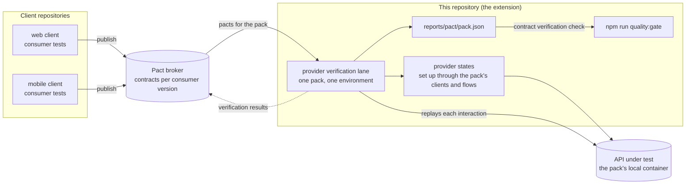

# Consumer-driven contracts as an extension

This framework tests an API from the provider's side. It starts from the OpenAPI document, checks
that the document and the deployed service agree, and turns the document into designed cases.
Consumer-driven contract testing, of which Pact is the best-known tool, starts from the other end:
from what each client of the API actually sends and reads. This page explains what that approach
adds, when it is worth its cost, and where it would sit next to the lanes and the quality gate.

**Nothing on this page is implemented.** The framework has no Pact dependency, no broker and no
verification lane. The page is a design for adding them, written so that the extension reuses the
pieces that exist instead of growing a second structure beside them.

## What each side checks

The provider-side tools answer questions about the contract as published. Consumer-driven contracts
answer questions about the contract as used.

| Question | Answered here today by | What a consumer contract adds |
|---|---|---|
| Does the deployed service still match its document? | `contract:digest:live` and the daily drift run ([contract tooling](../contract-tooling.md)) | nothing; this stays a provider check |
| Which values, codes and boundaries does the document allow? | value sets, the probe matrix and the floor ([contract tooling](../contract-tooling.md)) | nothing; consumers rarely exercise boundaries on purpose |
| Does the service behave as the document says? | the specs of each pack, designed from its [contract analysis](../references/contract-analysis.md) | nothing; behaviour stays with the designed cases |
| Which fields and interactions does each client depend on? | nobody | a recorded list per consumer: the requests it sends and the parts of each answer it reads |
| Can the provider remove or rename a field? | only by reading every client's code | a verification run that fails when a consumer still reads it |
| Can this version of a client or of the service go to an environment? | nobody | a deployment check against the verified pairs of versions (Pact's `can-i-deploy`) |

The two kinds of contract fail for different reasons. A provider contract fails when the service
departs from its document, whether or not anyone relies on the part that changed. A consumer
contract fails only when a change breaks a client that exists. So a consumer contract is narrower,
and it is also the only one that knows which parts of the document are load-bearing.

## When it pays off

Consumer-driven contracts need cooperation from both sides: the client teams write consumer tests
that record their expectations, and the provider runs those expectations against its build. That
cost pays off when:

- the API has **several clients that the same organisation owns**, released on their own schedules,
  such as a web front end, a mobile app and other services;
- the provider wants to **change its responses without a coordinated release**, and needs to know
  which fields are safe to drop;
- **both sides run CI** that can publish and verify contracts, and a broker can be hosted for them.

It does not pay off, and the provider-side tools are enough, when:

- the API is **public or owned by a third party**, like the Petstore image in the example pack:
  nobody here can run verification in its CI, and its clients are unknown;
- there is **a single client**, released together with the service, so an integration test of the
  two covers the same ground;
- the clients are **not under your control**, so their expectations cannot be recorded.

A team that tests a vendor's API with this framework has no use for it. A team that owns both the
API and its clients can add it without giving up anything the framework already checks.

## Where it would sit

Consumer tests live in the client repositories, not here. They run against a mock that the
consumer-side library starts, and each run writes a contract file (a pact) that a broker stores
under the consumer's version. The framework's part would be the provider side: fetch the pacts that
concern a pack from the broker, replay them against the pack's service, and report the result.

### The verification lane

It would be another lane next to DAST and performance ([lanes](../quality-gates.md#lanes)), run as
`npm run lanes:<name> -- --service <pack>` and following the same rules those lanes follow:

- **The environment comes from qa-config.** The base URL and the credentials of the pack's entry in
  the active environment, as for every other lane ([ADR 0009](../adr/0009-per-pack-configuration.md)).
  Verification creates the records each interaction expects, so it would run only where the entry
  has `allow_writes: true`, and run the entry's `recovery` afterwards, as the DAST lane does.
- **Provider states reuse the pack.** A pact names the state an interaction needs ("a pet with id
  10 exists"). The lane would map each state name to a function in the pack that builds it through
  the pack's clients, builders and flows, the layers of
  [ADR 0007](../adr/0007-layered-test-architecture.md), and removes it afterwards. A state that has
  no function is a failure, not a skip.
- **Credentials come from the actors.** An interaction recorded with a token is replayed with the
  credential of the pack's actor for that state, obtained by the same strategies the specs and the
  other lanes use (`scripts/lib/auth-tokens.mjs`). No credential is stored in a pact or in the
  broker's copy of it.
- **The lane judges, the gate counts.** The lane fails on an interaction that did not verify. It
  writes `reports/pact/<pack>.json`, and the quality gate reads it through a new strategy in
  `STRATEGIES` in `scripts/quality-gate.mjs`, configured under `quality_gate` like the others
  ([quality gate](../quality-gates.md#quality-gate)). A missing report is SKIPPED unless the check is
  `required`.
- **Results go back to the broker** only from CI on the main branch, so a local run never marks a
  provider version as verified.

### What changes in a pack

A pack that opts in would gain one file and one folder, both optional like `dast-rules.tsv` and
`perf.json`:

| Path | Would hold |
|---|---|
| `services/<pack>/pact.json` | the provider name in the broker and which consumers and tags to verify |
| `services/<pack>/provider-states/` | one function per state name, built from the pack's clients and flows |

The broker's URL and token would be read from the environment, like every other credential.

### How it relates to the designed cases

Verified interactions are not designed cases. They have no registry row, no technique and no
identity in the test-management tool, and they do not count towards the floor. A failed
interaction is either a provider change that breaks a client, which is a decision for the two
teams, or a defect in the service, which is triaged and filed like any other finding
([bug reporting](../references/bug-reporting.md)). When a consumer depends on behaviour the
document does not state, that is a contract gap worth a note in the pack's `contract-notes.md` and,
at the next design phase, a designed case of its own.

## Before building it

- Decide where the broker runs and who owns it; the framework would only read from it and report
  to it.
- Start with one pack whose API you own and one client that already has consumer tests.
- Record the decision in an ADR: the lane, the state functions and the gate check are a new
  extension point, and they change what a pack may hold.
